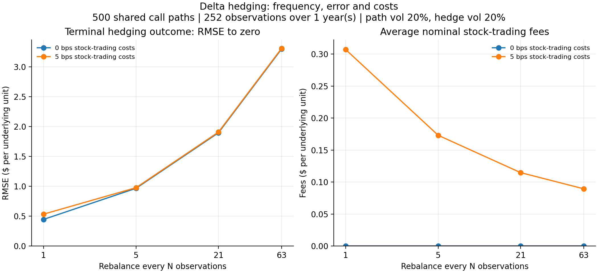

# Quant Risk Lab

**Option pricing, numerical validation, and the cost of discrete delta hedging.**

Quant Risk Lab is a Python research project that investigates how hedge
frequency, stock-trading costs, and incorrect volatility assumptions affect
the residual outcomes of a hedged European option. A local Streamlit dashboard
connects the pricing engines, risk sensitivities, transaction ledger, and
reproducible simulation studies.

Project owner: **Deewash Sharma**. Implementation and documentation were
developed with ChatGPT assistance. The project is an independent learning and
research exercise; it is not a published academic result.

## Research questions

1. How do numerical pricing estimates compare with Black–Scholes, and how does
   numerical or sampling error change with computational effort?
2. At a fixed payoff-evaluation budget, how much does antithetic sampling reduce
   the variance of Monte Carlo price estimates?
3. How does the frequency of stock-hedge adjustment trade off residual error
   against transaction costs?
4. With stock paths and entry premium held fixed, how do incorrect volatility
   assumptions affect the distribution of hedging outcomes?

## Features

| Area | Implementation |
| --- | --- |
| Pricing | Black–Scholes, a CRR binomial tree, plain Monte Carlo, and antithetic Monte Carlo |
| Risk measures | Analytical delta, gamma, and vega, checked against price perturbations |
| Numerical experiments | Finite-difference accuracy, odd/even tree convergence, sampling error and interval coverage |
| Hedging | Self-financing stock/cash ledger, financing, proportional fees, liquidation and settlement |
| Research | Common-path frequency/cost and fixed-premium volatility studies |
| Interface | Interactive pricing, single-path hedging, saved results, and new studies with CSV downloads |

## Quick start

Open a terminal in this folder. On macOS or Linux:

```bash
python3 -m venv .venv
source .venv/bin/activate
python -m pip install --upgrade pip
python -m pip install -r requirements.txt
python -m unittest discover -v
python -m streamlit run dashboard.py --server.address 127.0.0.1
```

Open [the local dashboard](http://localhost:8501). Keep the terminal running;
press Control+C to stop the server. The numerical modules use the Python
standard library. Streamlit, pandas, and Matplotlib provide the interface and
plots. Run numerical examples from the project root so local imports resolve.

The source uses Python 3.9-compatible syntax. Reference checks were run on
Python 3.12.14; a local Mac/Python 3.9 run was also reported during development.
Exact dependencies for that Mac run were not captured. See
[reproducibility](docs/REPRODUCIBILITY.md) for the tested environment and how to
record your own resolved versions.

A fully resolved Linux/Python 3.12.14 reference dependency file is also included;
use the portable requirements.txt for the Mac/Python 3.9 setup.

## Reference findings

All figures below refer to controlled model simulations, not observed market
returns. Monetary values are per underlying unit, before any contract multiplier.

| Experiment | Selected result |
| --- | --- |
| Pricing benchmark | For S=K=100, T=1, r=5%, sigma=20%, Black–Scholes gives call 10.450584 and put 5.573526 |
| Tree convergence | The 1,000-step tree has about 0.001999 absolute error for each option in that example |
| Antithetic sampling | Across 100 repetitions at 10,000 payoff evaluations, empirical variance factors are 1.912 for calls and 1.607 for puts |
| Hedge frequency | On 500 common paths without fees, residual RMSE rises from 0.445153 at interval 1 to 1.894973 at interval 21 |
| Trading fees | At 5 bps, average nominal fees fall from 0.306943 at interval 1 to 0.114711 at interval 21 |
| Volatility assumptions | Daily no-fee hedge RMSE is 0.935929, 0.445153, and 0.806302 for assumed volatility 15%, 20%, and 25%, respectively, with true volatility and entry premium fixed |

These are finite-sample results for specified parameters. They do not establish
a universally optimal hedge schedule. Detailed tables, interpretation, and
limitations are in [the research findings](docs/RESEARCH_FINDINGS.md).



## Reproduce the experiments

```bash
python reproduce.py
```

This rebuilds CSVs and figures, saves individual command logs, and records
the interpreter, direct dependency versions, executed commands, and source and
output SHA-256 hashes in `results/run_manifest.json`.

For a shorter installation check, run `python reproduce.py --quick`. Quick mode
uses smaller repeated studies and therefore replaces the reference summaries
with a different configuration. Run the full command again before comparing
with the reference tables. The dashboard displays the recorded configuration.

## Tests

```bash
python -m unittest discover -v
python check_dashboard.py
```

The package contains **71 unit test methods** and **four optional headless UI
test methods**, with additional grid cases inside several methods. Tests check
financial identities, independent numerical derivatives, online statistics,
pair-based standard errors, cash conservation, fee financing, information
timing, common-path comparisons, adapter units, and UI workflows. They do not
prove correctness for every floating-point input.

The GitHub Actions workflow is configured to run numerical tests on Python 3.9
and 3.12 and dashboard checks on Python 3.12. The workflow has been prepared but
has not been executed on GitHub as part of this package.

## Project map

| Files | Responsibility |
| --- | --- |
| `black_scholes.py`, `binomial.py`, `monte_carlo.py`, `antithetic.py` | Independent pricing implementations |
| `greeks.py`, `check_greeks.py` | Sensitivities and derivative validation |
| `hedging.py`, `run_hedge.py` | Path generation and audited single-path hedging |
| `mc_repeated_experiment.py`, `compare_variance_reduction.py` | Repeated estimator experiments |
| `hedging_study.py`, `volatility_study.py` | Main hedging studies and summary statistics |
| `dashboard.py`, `dashboard_support.py` | UI and tested adapters to the models |
| `compare_*.py`, `delta_experiment.py`, `plot_*.py` | Runnable demonstrations and figure generation |
| `test_*.py`, `check_dashboard.py` | Unit tests and optional UI checks |
| `reproduce.py` | Reproduction pipeline and provenance manifest |
| `docs/`, `results/` | Documentation and reference outputs |

## Scope

European vanilla options, no dividends, constant rates and volatility,
fractional stock positions, the same borrowing/lending rate, and proportional
stock-trading fees. Stock paths are risk-neutral GBM simulations. The baseline
does not include live data, brokerage execution, option bid/ask spreads,
stock-borrow charges, margin constraints, price impact, or stochastic volatility.

Normal-approximation Monte Carlo intervals describe sampling uncertainty within
the assumed model. They can be unreliable for rare-event payoffs. Numerical
extremes can exceed floating-point range. The hedging studies are finite
simulation experiments, not demonstrations of real-market profitability.

## Documentation

- [Dashboard setup and usage](docs/DASHBOARD_SETUP.md)
- [Architecture and accounting](docs/ARCHITECTURE.md)
- [Reproduction instructions and experiment configurations](docs/REPRODUCIBILITY.md)
- [Research findings and limitations](docs/RESEARCH_FINDINGS.md)
- [Local version-control preparation](docs/VERSION_CONTROL.md)
- [References](docs/REFERENCES.md)
