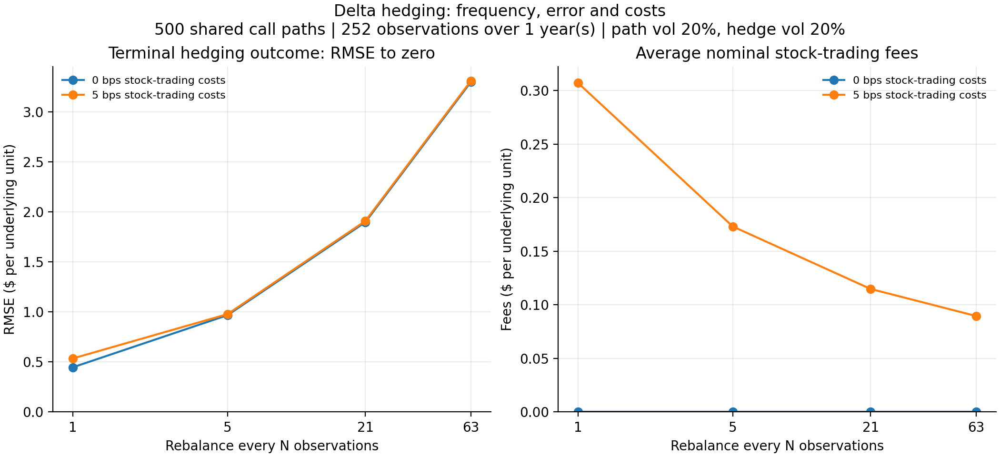
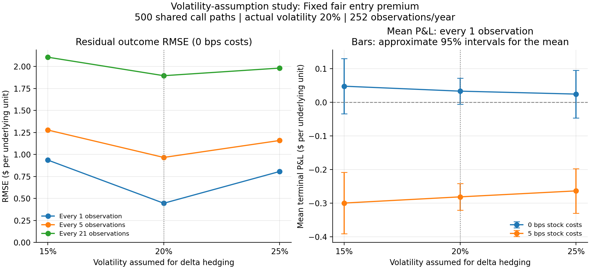

# Numerical experiments and research findings

## Purpose and scope

This project studies numerical pricing accuracy and discrete hedging outcomes
under a controlled Black–Scholes/GBM model. Its main question is how adjustment
frequency, stock-trading costs and hedge-volatility assumptions change residual
option-hedging risk. Model parameters, seeds and policies are recorded so the
experiments can be reproduced and extended.

This document summarizes the reference run, rather than making claims about
observed financial markets. It is a project findings note, not a peer-reviewed
paper. See REPRODUCIBILITY.md for commands and dependency/version information.

## Pricing and numerical accuracy

For S=K=100, T=1, r=5%, sigma=20% and no dividends, the analytical call and put
prices are 10.450584 and 5.573526. At 1,000 CRR steps, estimates are 10.448584
and 5.571527, each about 0.001999 from the analytical reference.

Tree convergence is oscillatory. The call's absolute error falls from 0.197175
at 10 steps to 0.160617 at 11, then rises to 0.164734 at 12. Increasing the
step count by one does not guarantee a smaller error. Odd/even behavior is
therefore retained in the comparison driver.

For numerical delta, a central finite-difference sweep shows second-order
truncation behavior at larger steps, followed by roundoff-dominated error at
very small steps. In the initial reference example, h=10^-4 gave the smallest
call error among the tested steps. That is an observation for one configuration,
not a universal step-size recommendation.

Gamma and vega agree with numerical price derivatives over the test grid. In
the standard call example, gamma is about 0.01876202 and vega is 37.52403469 per
unit decimal volatility, or 0.37524035 per volatility percentage point. For a
$1 stock increase, delta predicts a 0.636831 price change; delta plus gamma
predicts 0.646212, close to full repricing at 0.646125.

## Monte Carlo uncertainty

The seed-7 call example reports standard errors of 0.146425, 0.072964 and
0.036787 at 10,000, 40,000 and 160,000 payoffs. Quadrupling the sample count
roughly halves the standard error, consistent with the inverse-square-root rate.
Realized absolute errors need not decrease at every larger sample size.

In a separate 100-repetition study, calls have approximate 95% interval coverage
of 91%, 94% and 97% at 1,000, 4,000 and 16,000 samples. Put coverage is 95%,
96% and 99%. These finite-repetition percentages are not sufficient to prove
uniform nominal coverage. Additional replications and rare-payoff cases would
be needed to assess calibration more thoroughly.

## Antithetic sampling at equal budgets

For 100 repeated estimates, each method evaluates 10,000 terminal payoffs.
Antithetic sampling uses 5,000 independent pairs. Standard errors are computed
from pair averages, accounting for dependence within each pair.

| Option | Plain RMSE | Antithetic RMSE | Empirical variance factor |
| --- | ---: | ---: | ---: |
| Call | 0.141188 | 0.101667 | 1.912 |
| Put | 0.083961 | 0.065756 | 1.607 |

Both options show lower empirical variance and RMSE in this configuration. The
factor is an estimate from repeated price outcomes, not a measured execution
speedup. The methods share seeds for comparison; trial outcomes across methods
are paired. A finite study does not guarantee a smaller error for every seed.

## Hedge frequency and stock-trading fees

The main study sells one call unit at its fair model price and hedges it using
stock/cash. Five hundred risk-neutral paths share the same 252-observation
grid. Every policy on a given seed uses the exact same stock path. Opening,
rebalancing, financing, final stock liquidation and option settlement are booked.

| Rebalance interval | No-fee residual RMSE | RMSE at 5 bps | Mean nominal fees at 5 bps |
| ---: | ---: | ---: | ---: |
| 1 | 0.445153 | 0.533382 | 0.306943 |
| 5 | 0.965824 | 0.976154 | 0.173035 |
| 21 | 1.894973 | 1.906591 | 0.114711 |
| 63 | 3.296179 | 3.307113 | 0.089451 |

Less frequent hedging lowers average fees while increasing residual RMSE in
this run. At 5 bps, interval 1 has the smallest RMSE among tested schedules,
while interval 5 has a less negative sample mean P&L. A preferred schedule
therefore depends on an explicit objective, rather than a single universal
definition of best. Sample-mean differences should be assessed using the paired
path observations before making strong claims.

RMSE after fees includes systematic cost drag as well as random variation.
Sample standard deviation centers outcomes around their mean, while RMSE
centers around zero. Nominal fee totals also differ from terminal financing
drag, because earlier charges influence cash interest over the remaining time.

## Incorrect volatility with entry pricing controlled

The next study fixes actual simulated volatility at 20% and changes hedge
volatility to 15%, 20% or 25%. All policies receive the same 10.450584 entry
premium. This separates a changed hedge rule from a changed option sale price.

| Assumed hedge volatility | Daily no-fee residual RMSE |
| ---: | ---: |
| 15% | 0.935929 |
| 20% | 0.445153 |
| 25% | 0.806302 |

Using the correct assumption gives lower RMSE in this comparison. With the
fair fixed premium and risk-neutral dynamics, however, an admissible
self-financing hedge has zero expected discounted P&L before costs. A wrong
delta rule can increase dispersion without necessarily making the mean negative.
Finite sample means have uncertainty and should not be treated as guaranteed
profit or loss.

The optional hedge_model premium protocol also changes entry pricing. Its
no-cost expected terminal P&L benchmark is the entry-premium difference from
the true-volatility model price, accumulated at the cash rate. Tests verify
the exact pathwise cash shift when premium changes while hedge trades stay fixed.

## Limitations and extensions

The current evidence uses a small number of parameter configurations and a
known simulated volatility. It omits market data, dividends, stochastic
volatility, jumps, spreads in the option sale, funding asymmetry, margin
constraints, stock-borrow fees and price impact. Tail estimates from 500 paths
remain exploratory. Counterparties and execution failures are not modeled.

Useful extensions include broader parameter grids, paired confidence intervals
for policy differences, larger replication sets for coverage, independent
implementation benchmarks such as QuantLib, timing comparisons, and empirical
market-data studies with explicit data-quality controls. These are future work,
not completed features of the present release.

The central contribution of this version is a reproducible connection between
validated pricing components, explicit hedge accounting, controlled comparisons
and an interface for inspecting results and assumptions.
